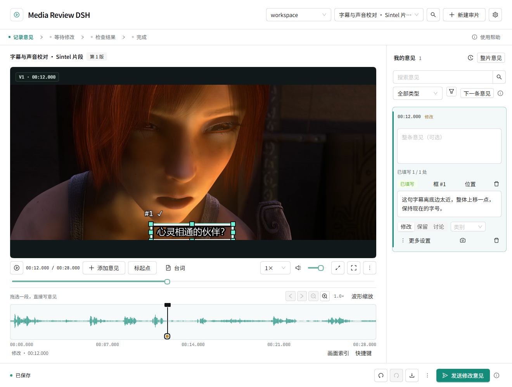
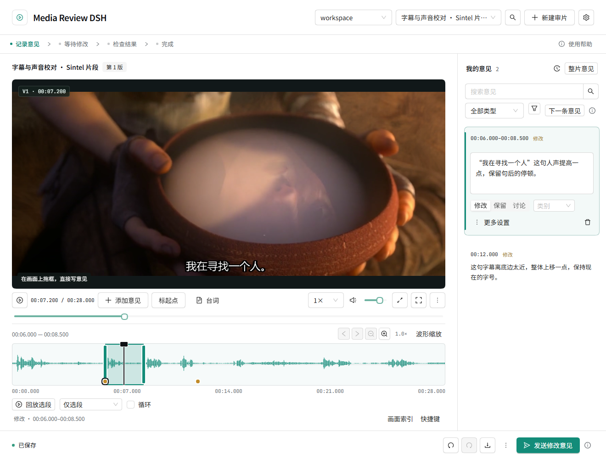
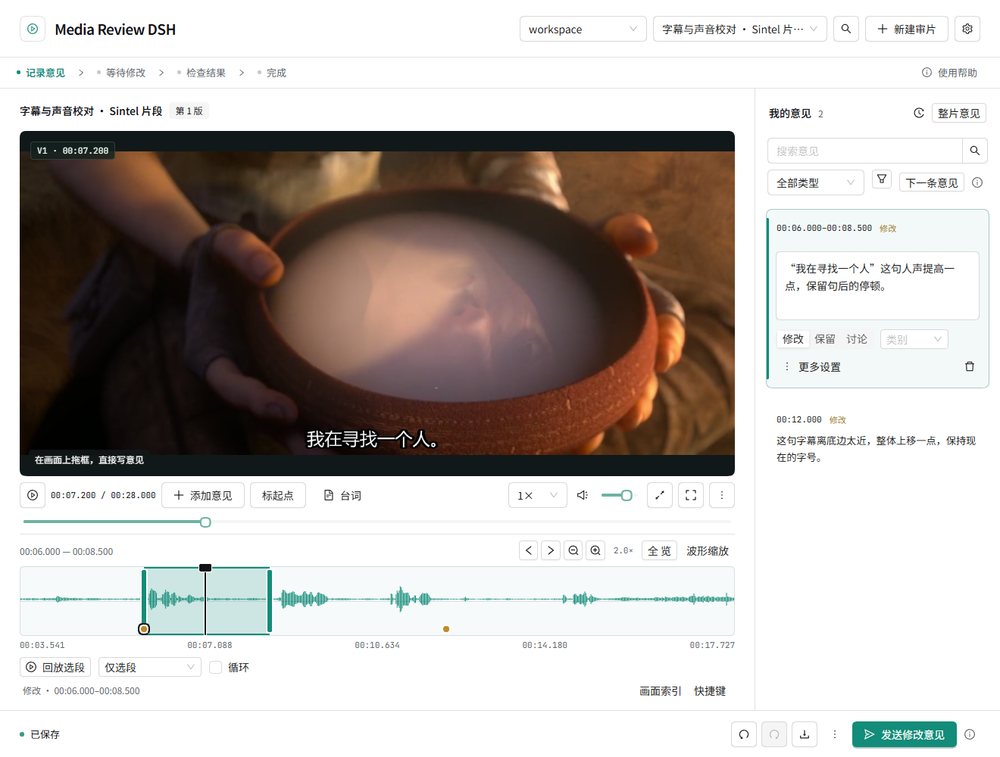

# Media Review DSH · 界面实拍

同一段有对白、停顿和中文字幕的影片，怎样边看边记修改意见？下面三张图来自已安装的 **0.1.0-rc.6** 插件，在 Windows / DeepSeek Harness 0.2.2-rc.1 独立环境中实际操作并保存后截取。

## 停在一帧，直接拖框写意见

暂停在字幕出现的一帧，直接框住字幕，写下“离底边太近，整体上移一点”。画面位置和文字意见一起保存。

## 拖出一段声音，直接写意见

在波形上拖选 **00:06–00:08.5**，给“我在寻找一个人”这句对白写声音意见。选中范围后即可输入，也可以回放选段或循环试听。

## 滚轮放大时间轴，波形区域保持紧凑

在同一选段附近滚动鼠标滚轮，把时间轴放大到约 **2 倍**。声音强弱沿用整段音轨的同一比例，波形区域始终为 **92 像素高**。

这些截图使用《Sintel》的 28 秒对白片段，保留原音轨，为演示字幕位置校对添加了中文字幕。影片画面：© Blender Foundation · [项目来源](https://durian.blender.org/) · [CC BY 3.0](https://creativecommons.org/licenses/by/3.0/)。[素材与改动说明](assets/screenshots/ATTRIBUTION.md)

本次已检查框选、选段、保存、选段播放和滚轮缩放，并核对波形数据与实际音轨；[截图验证记录](verification/showcase-real-media-check.json)。以上展示标注操作，不代表该影片已由模型返修。真实模型返修的既有验证范围见 [最终验证记录](FINAL-VERIFICATION.md)；安装与使用见 [安装指南](INSTALL.md)。
