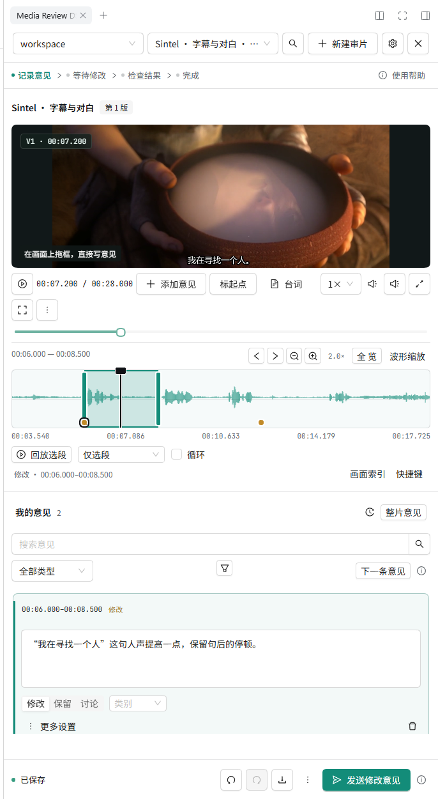

# Media Review DSH · 侧栏版实拍

**在其他 Agent 中审片：**[下载 Media Review Skill](https://github.com/Ww-Cooooo/media-review/releases/tag/v0.3.0-beta.11)（Windows，Agent 需能访问本机文件并执行命令）。

同一段有对白、停顿和中文字幕的影片，边看边留下修改意见。以下截图来自已安装的 **0.1.0-rc.8**，在 Windows / DeepSeek Harness 0.2.2-rc.1 独立环境中实际操作后，按入口或侧栏区域截取。

## 收起之后，从输入框上方重新打开

当前对话有送审记录时，**打开审片台**固定在输入框上方。作品送来时自动展开；点审片台右上角的 **×** 收起，再点这个按钮就能找回。

## 停在一帧，直接框住要改的地方

审片台在右侧展开。暂停影片、框住字幕，直接写“这句字幕离底边太近，整体上移一点，保持现在的字号”。宽侧栏中，视频和意见并排。

## 拖选对白，滚轮放大检查

拖选 **00:06–00:08.5**，给“我在寻找一个人”这句对白写声音意见。鼠标滚轮放大时间轴，波形仍保持 **92 px**，显示实际音轨的强弱起伏。

## 拖窄侧栏，内容自动上下排列

拖动左边缘调宽。窄时视频与意见上下排列，当前意见、播放位置和框选继续保留。

素材来自《Sintel》，© Blender Foundation · [原作](https://durian.blender.org/) · [CC BY 3.0](https://creativecommons.org/licenses/by/3.0/)。本地截取 28 秒对白并添加中文字幕，音轨未调整音量；[素材与改动说明](assets/screenshots/ATTRIBUTION.md)。示例意见用于展示标注操作，未调用模型返修这次演示。

[本次实拍检查](verification/showcase-rc8-check.json) · [本地客户端实测](FINAL-VERIFICATION.md) · [安装和使用](INSTALL.md)
